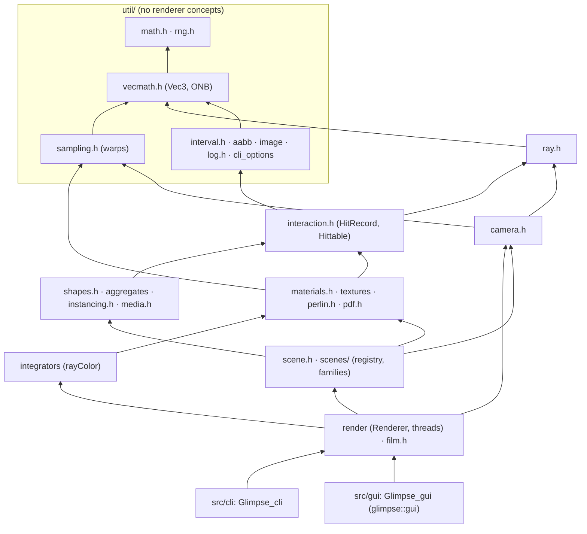
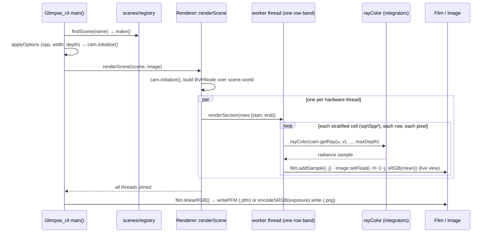
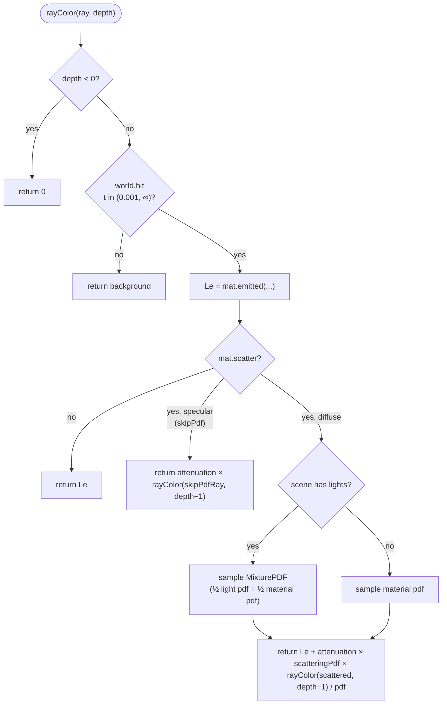
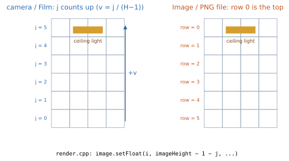
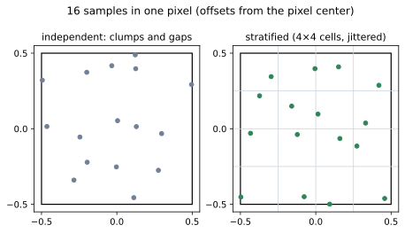
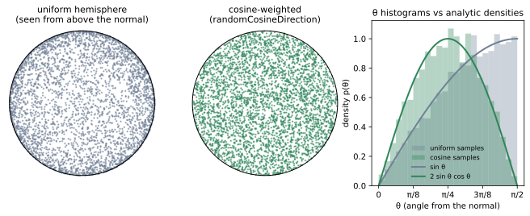

# Glimpse architecture

How the pieces fit together, as of the end of Stage 0. Each technique note (`docs/techniques/NN_name.md`) shows
what changes against this picture. Figures are generated by `tools/diagrams.py` (see `docs/PLAN.md`, "Diagrams").

## pbrt alignment

Glimpse started from *Ray Tracing in One Weekend*, whose class model is simpler than pbrt-v4's (pbrt ch1, §1.3:
"pbrt: System Overview"). The plan converges on pbrt's model one technique at a time, with no big-bang rewrite.
When a technique closes a gap, update its row and say so in the technique note.

| pbrt-v4 type (ch1) | Glimpse today (RTIOW-shaped) | Gap | Closed by |
|---|---|---|---|
| `Integrator` → `RayIntegrator` → `SimplePathIntegrator` / `PathIntegrator` (§1.3.3–1.3.5, §13.3–13.4) | free function `rayColor` (recursive, like pbrt's `RandomWalkIntegrator`, §1.3.6) | no integrator object, no `--integrator` | 07 (class + `SimplePathIntegrator`), 08 (`PathIntegrator`), 09 (MIS) |
| `Sampler` (§8.3) | `randomDouble()` calls in camera, materials, pdfs | no sample dimensions, no deterministic per-pixel streams | 03 (seeding), 04 (`Sampler`) |
| `Filter` (§8.8) | implicit box filter over a stratified pixel | no reconstruction filter | 06 |
| `Film` (§5.4) | `Film` (sums, `linearRGB()`) + `Image` | no sensor/filter weights, no variance | 01 (linear output) ✅, 05 (variance), 06 (filter weights) |
| `Camera` → `CameraSample`, `CameraRay` (§5.1) | `Camera::getRay(u, v)` draws its own random numbers | camera doesn't take sampler-provided samples | 04 |
| `Shape` (§6.1) and `Primitive` / `GeometricPrimitive` (§7.1) | one `Hittable` = geometry + material (+ light-sampling hooks) | shape and primitive are fused | 14 |
| `Light`, `DiffuseAreaLight`, `LightSampler` (§12.1, §12.4, §12.6) | emitters are `Hittable`s with `DiffuseLight`, duplicated by hand into `scene.lights` | no light objects, no light sampler | 08 (`Light`, `UniformLightSampler`), 17 (infinite light), 18 (power/BVH samplers) |
| `BxDF` / `BSDF` / `Material` (§9.1, §10.5) | `Material::scatter` → `ScatterRecord` (pdf or fixed ray) | no BSDF evaluation/sampling interface | 11 |
| `SurfaceInteraction` (§3.11) | `HitRecord` | fewer fields (no shading frame, no light pointer) | grows with 08, 11, 14 |
| `Spectrum`, `SampledWavelengths` (§4.5) | `Color` = RGB `Vec3` (double) | RGB only | 19 |
| `Medium`, `PhaseFunction` (§11) | `ConstantMedium` is a `Hittable` | media aren't attached to primitives or rays | 20 |
| `Texture` (§10.3) | `Texture::value(u, v, p)` | no differentials/filtering | backlog (§10.1, §10.4) |
| `Aggregate` / `BVHAggregate` (§7.2–7.3) | `BVHNode` (midpoint split, pointer tree) | no SAH, not flattened | 15 |

## Modules

Arrows point from a module to what it uses. Everything under `src/glimpse/` is the `Glimpse` static library;
the CLI, the viewer and the tests link it.

## One render, end to end (CLI)

The viewer drives the same `renderScene` from a background thread (`gui/raytracer.h`) and uploads the `Image`
as a texture every frame while it renders.

## One bounce of `rayColor`

The RTIOW / TROYL recursive estimator that techniques 07–09 replace. Each call returns a one-sample estimate of
the radiance arriving along the ray.

## Conventions worth a picture

**Image orientation.** Camera `v` and Film rows `j` count up from the bottom, while `Image` rows and image files
count down from the top. The renderer flips once, when it writes. The Stage 0 "upside-down images" bug was this
flip hidden in the viewer instead.

**Stratified pixel samples.** The renderer's `sampleSquareStratified` places one jittered sample in each of the
`sqrtSpp × sqrtSpp` sub-cells. That's also why `--spp 10` renders 9 samples.

**Cosine-weighted directions.** `CosinePDF` samples `randomCosineDirection`, whose density is `cos θ / π`. That
puts more samples near the normal, where a Lambertian surface's integrand is largest. Seen from above, the samples
are uniform over the disk (Malley's method).

