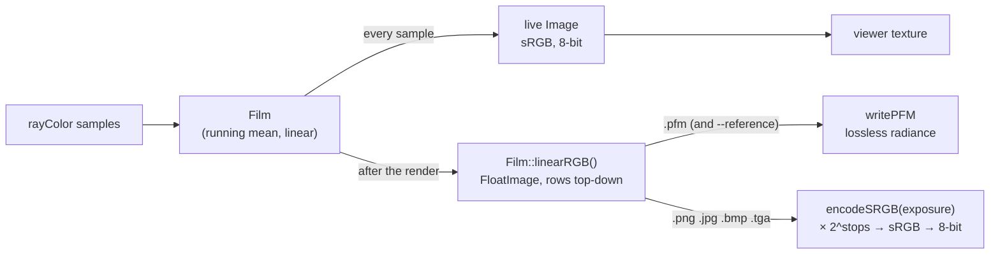
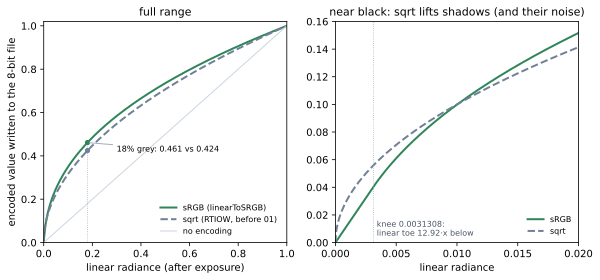
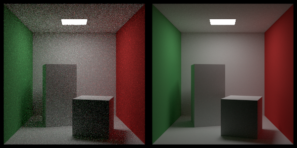

# 01 · float_output

**Stage:** 1 (Measuring) · **Status:** ✅ 2026-10-11

## Read

- pbrt-v4 §2.1 — [Monte Carlo: Basics](https://pbr-book.org/4ed/Monte_Carlo_Integration/Monte_Carlo_Basics.html):
  the estimator's expected value is the integral, which is what a high-spp reference converges to.
- pbrt-v4 §4.6 — [Color](https://pbr-book.org/4ed/Radiometry,_Spectra,_and_Color/Color.html): color spaces and the
  sRGB transfer function. Source: `pbrt-v4/src/pbrt/util/color.h` (`LinearToSRGB`, `LinearToSRGB8`).
- pbrt-v4 §5.4 — [Film and Imaging](https://pbr-book.org/4ed/Cameras_and_Film/Film_and_Imaging.html): the film
  stores linear sensor values; encoding for display happens on output. Source: `pbrt-v4/src/pbrt/film.h`.
- pbrt-v4 §B.5 — [Images](https://pbr-book.org/4ed/Utilities/Images.html): float image formats. Source:
  `pbrt-v4/src/pbrt/util/image.cpp` (`ReadPFM`, `WritePFM`).

## Idea

A path tracer estimates **radiance**, a linear physical quantity with no upper bound. The light in the Cornell box
has radiance 15. Before this technique, Glimpse only ever produced a *display* version of its estimate:
- squashed with `sqrt` as an approximate gamma
- clamped to [0, 1]
- quantised to 8 bits

That's fine to look at but useless to measure: every later technique compares a render against a reference, and
both have to be the linear estimate itself, not a lossy picture of it.

So the film's running mean is now written losslessly as PFM (raw float32). Display encoding becomes a separate,
explicit last step: exposure (`× 2^stops`), then the real sRGB curve, then 8 bits. sRGB has a linear toe near
black, where a pure power curve (like `sqrt`) has infinite slope and lifts the darkest values, along with their
noise. A **reference** is the same scene at 4096 spp, cached as `refs/<scene>.pfm`. Its own noise is far below
what the techniques under test leave, so "error vs reference" measures the technique.

## Diagrams

Where the linear estimate goes:



The display curves (`tools/diagrams.py srgb_vs_sqrt`):



Row order now matters in three places: camera `v` / Film `j` count up, `Image` / `FloatImage` rows count down,
and **PFM files store scanlines bottom-to-top**. `FloatImage` is top-down like `Image`, so the PFM flip lives only
inside `readPFM`/`writePFM` (see `docs/architecture.md`, image orientation).

## What changed

- `util/float_image.{h,cpp}` (new): `FloatImage` (linear, unclamped, row 0 = top) plus PFM read/write. Reading
  handles `PF`/`Pf`, both byte orders (the scale's sign) and `|scale|`, and rejects truncated files.
- `util/color.{h,cpp}` (new): `linearToSRGB`, and `encodeSRGB(FloatImage, exposureStops)` → 8-bit `Image`.
- `film.h`: `linearRGB()` returns the running mean as a `FloatImage` (rows flipped to top-down).
- `render.cpp`: the live `Image` (the viewer's view) uses sRGB instead of `sqrt`. Film stays linear.
- `cli/main.cpp`: the output comes from the linear film. `.pfm` writes it as-is (never exposure-scaled: it's the
  measurement); 8-bit formats get `encodeSRGB(linear, --exposure)`.
- `util/cli_options`: `--out x.pfm`, `--exposure STOPS` (−20..20), and `--reference` (4096 spp unless `--spp`;
  writes `refs/<scene>.pfm`; an explicit `--out` must be `.pfm`). `kReferenceSpp = 4096`.
- Tests: PFM (round trip, header bytes, bottom-row-first, big-endian with scale, grayscale, rejects), sRGB values
  and exposure, `Film::linearRGB` orientation, CLI flags. 42 tests in total.
- `CMakeLists.txt`: the library glob uses `CONFIGURE_DEPENDS` (new `.cpp` files were missed until reconfigure).

## Numbers

Cornell box, 300×300, AMD Ryzen 9 5900HX (16 threads), release build:

| | |
|---|---|
| Reference (`--reference`, 4096 spp, 64×64 strata) | **93 s**, `refs/cornell_box.pfm` = 1,080,014 bytes (300·300·3·4 + 14-byte header) |
| Max radiance in the PFM | **15.0**: exactly the light's emission (`DiffuseLight(Color(15, 15, 15))`) |
| Pixels with a channel > 1 (clip to white in 8-bit) | **0.62%** |
| Mean radiance, float vs 8-bit decoded | 0.155 vs 0.077: **8-bit loses 51% of the image's energy**, all in those 0.62% |
| 8-bit quantisation error, in-range channels | median 0.72%, 99th percentile 4.0%; darks (0.001–0.01): median 1.9% |
| PNG vs PFM consistency | 100% of PNG channels = `quantise(sRGB(pfm))`; `--exposure 1` = `quantise(sRGB(2·pfm))` |

64 spp next to the 4096-spp reference (both sRGB-encoded from PFM):



(Error numbers such as RMSE and relMSE against the reference are technique 02's job.)

## Gotchas

- **The 8-bit loss is energy, not looks.** The clipped light is a tiny area but half the radiance. Any metric
  computed on PNGs would be dominated by clipping, which is why references and comparisons are float.
- **PFM is bottom-to-top.** It's easy to write PFMs upside down and not notice in a viewer that flips them back.
  The test `first_scanline_in_file_is_the_bottom_row` pins it.
- **The quantiser differs from pbrt's.** Glimpse's `Image` uses `floor(256·v)`, while pbrt's `LinearToSRGB8` uses
  `round(255·v + dither)`. That only matters for 8-bit output, which is no longer used for measurement.
- **Exposure never touches PFM.** The float file is the measurement; exposure is a display choice.
- **Seeds:** render references with a different `--seed` from the runs you compare, so their noise isn't
  correlated.

## Repro

```bash
./build.sh
./run.sh cli --scene cornell_box --reference --width 300 --seed 101          # → refs/cornell_box.pfm, ~93 s
./run.sh cli --scene cornell_box --spp 64 --width 300 --seed 5 --out results/c64.pfm
./run.sh cli --scene cornell_box --spp 64 --width 300 --seed 5 --exposure 1 --out results/c64_plus1.png
tools/.venv/bin/python tools/diagrams.py srgb_vs_sqrt
```
