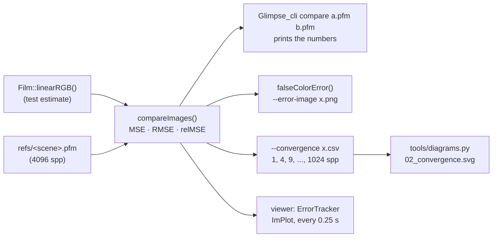
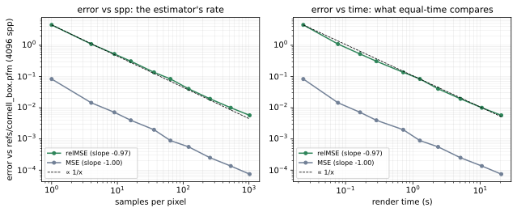
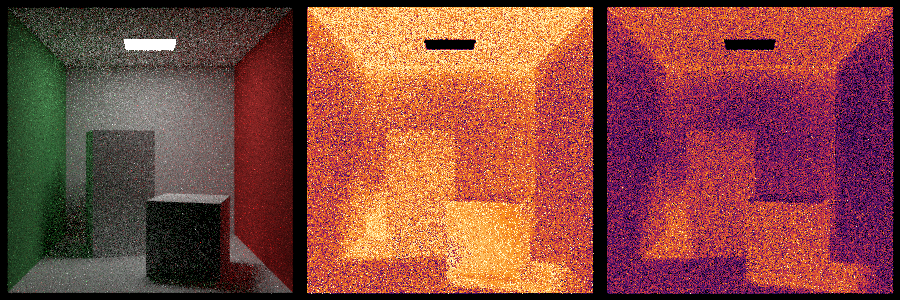

# 02 · error_metrics

**Stage:** 1 (Measuring) · **Status:** ✅ 2026-10-28

## Read

- pbrt-v4 §2.1 — [Monte Carlo: Basics](https://pbr-book.org/4ed/Monte_Carlo_Integration/Monte_Carlo_Basics.html):
  §2.1.4 "Error in Monte Carlo Estimators" defines variance, bias, MSE and **efficiency** = 1 / (variance · time).
- pbrt-v4 §2.2 — [Improving Efficiency](https://pbr-book.org/4ed/Monte_Carlo_Integration/Improving_Efficiency.html):
  the techniques of Stages 2–3 are all ways to lower variance per unit of time.
- pbrt-v4 §B.5 — [Images](https://pbr-book.org/4ed/Utilities/Images.html). Source:
  `pbrt-v4/src/pbrt/util/image.cpp` (`Image::MSE`, `Image::MRSE`) and `pbrt-v4/src/pbrt/cmd/imgtool.cpp` (`diff`).
- RTG1 ch15 — *On the Importance of Sampling* ([Ray Tracing Gems, open access](https://link.springer.com/book/10.1007/978-1-4842-4427-2)):
  why variance is the quantity to watch, and how sampling choices move it.

## Idea

A render is a Monte Carlo estimate, so its error against the true image is mostly **variance**: noise that falls
as 1/N with N samples per pixel (for an unbiased estimator, MSE = variance + bias², and bias is 0). Every later
technique claims "less noise", and this technique turns that into a number by comparing a render with a
converged **reference** (01's `refs/<scene>.pfm`).

Two metrics, both from pbrt:
- **MSE / RMSE:** the mean squared difference. It is in radiance units, so the brightest pixels dominate it.
- **relMSE** (pbrt calls it MRSE): each pixel's squared error divided by (reference + 0.01)². A 10% error then
  counts the same on a dark wall as on a bright one, which matches what the eye sees as noise. This is the number
  rendering papers report, and the one later notes lead with.

One number per image hides *where* the error is, so there is also a false-colour map of per-pixel relMSE.

Error alone doesn't decide between methods: a technique that halves the variance but triples the time per sample
loses. pbrt's **efficiency** is 1 / (variance · time), so the fair test is **equal time**: give both methods the
same seconds and compare the error. The convergence mode records error against both spp and seconds for that.

## Diagrams

Where the numbers come from and where they go:



Convergence of cornell_box (`tools/diagrams.py 02_convergence`, data in `docs/data/`):



Both curves follow the 1/x guide: the renderer is an unbiased estimator converging at the Monte Carlo rate. The
two panels look the same because render time is almost exactly proportional to spp (fitted slope 0.99). They will
differ once a technique changes the cost of a sample.

16 spp, its error map, and the error map at 256 spp (log scale from 10⁻⁴ (black) to 1 (pale yellow); NaN/inf
would be cyan):



The light is black: camera rays that hit it return its emission exactly. The **ceiling** is the brightest area of
the map, because the light faces down, so the ceiling is lit only by indirect bounces, which have the highest
variance. 16× more samples lowers relMSE 16× (0.308 → 0.0193), which moves every pixel down about 1.2 of the
scale's 4 decades. The pattern stays the same and the whole map gets darker.

## What changed

- `util/metrics.{h,cpp}` (new): `compareImages` → `ErrorStats {mse, rmse, relMSE, nonFinite}` and
  `falseColorError` (log-scale colour map of per-pixel relMSE). Defined like pbrt's `Image::MSE` / `Image::MRSE`.
  NaN/inf values are skipped but counted, and the mean still divides by every value, so a NaN can't make an image
  look better.
- `cli/main.cpp`, `util/cli_options`: a **`compare` subcommand**,
  `Glimpse_cli compare <test.pfm> <ref.pfm> [--error-image out.png]`. It accepts only `.pfm` input: comparing 8-bit
  images would measure the tone curve and the clipping (01), not the estimator.
- `convergence.{h,cpp}` (new) and **`--convergence out.csv`**: render at spp 1, 4, 9, 16, 36, 64, 121, 256, 529,
  1024 (perfect squares for the stratified grid, about doubling each step) up to `--spp` (default 1024). The size is
  taken from the reference. Each point is a separate render, timed including its BVH build, and the CSV has columns
  `spp,seconds,mse,rmse,relmse`.
- `tools/diagrams.py`: `02_convergence`, drawn from the committed CSV, with fitted log-log slopes in the legend.
- Viewer (`src/gui`):
  - `error_tracker.h` (new) loads the scene's reference and samples the live film against it every 0.25 s. It only
    measures while the viewer renders the reference's exact image (size, camera, depth, background); otherwise it
    shows why not. A "Match reference size" button sets the reference's width.
  - The control panel shows elapsed time, average spp and Msamples/s for every render, plus an ImPlot log-log plot
    of relMSE against spp or time. The ImPlot context is now created; ImPlot was vendored but never initialized.
- `render.h/.cpp`: the progress counter is `std::atomic<int64_t>`. With 32 bits, an uncapped 600×600 render
  overflowed after about 8 minutes, and samples/s would have gone wrong.
- `gui/gl_res.cpp`: `setupFramebuffer` deletes the previous texture. It leaked one on every scene change.
- Tests: metrics (exact values, relMSE weighting, NaN handling, false colour), `compare` and `--convergence`
  parsing, the spp schedule, convergence against a scene with an exactly known image, the CSV, and the viewer's
  `ErrorTracker`. 46 tests in total.

## pbrt alignment

No class-model gap closes here. The metrics are pbrt's (`Image::MSE`, `Image::MRSE` with the same +0.01), so
numbers in these notes can be compared with `imgtool diff` output and with papers that use pbrt. One difference:
pbrt skips only infinite per-pixel errors; Glimpse skips any NaN/inf value and reports how many it skipped.

## Numbers

Cornell box, 300×300, depth 50, seed 1, against `refs/cornell_box.pfm` (4096 spp, seed 101); AMD Ryzen 9 5900HX,
16 threads, release build:

| spp | seconds | RMSE | relMSE |
|---:|---:|---:|---:|
| 1 | 0.024 | 0.288 | 4.49 |
| 4 | 0.077 | 0.120 | 1.09 |
| 16 | 0.287 | 0.0628 | 0.308 |
| 64 | 1.27 | 0.0297 | 0.0833 |
| 256 | 5.10 | 0.0158 | 0.0193 |
| 1024 | 20.6 | 0.00863 | 0.00571 |

- **Fitted log-log slopes:** MSE −1.00 and relMSE −0.97 against spp; −1.00 and −0.97 against seconds.
- **Throughput:** about 4.6 M samples/s in the CLI.
- **`compare` and `--convergence` agree:** the 16 and 64 spp rows match `compare` run on separately rendered PFMs
  with the same seed, to every printed digit.
- **The reference's own noise is part of the error.** If the test and reference use independent seeds, the
  expected error is Var(test) + Var(ref). At 1024 spp against a 4096-spp reference, that is +25%. Measured with two
  independent 1024-spp renders:

  | | relMSE |
  |---|---:|
  | seed 1 vs reference | 0.00571 |
  | seed 2 vs reference | 0.00580 |
  | seed 1 vs seed 2 (= 2 · Var(1024)) | 0.00917 |

  Var(1024) ≈ 0.00459, so the reference contributes 0.00576 − 0.00459 ≈ 0.00117, or **25%**, as predicted. That is
  also why relMSE's slope is −0.97 rather than −1: the reference's noise is a constant floor that matters more as
  the test image converges. Below about ¼ of the reference's spp, the floor is under 6%.
- **Viewer** (cornell_box at 300 wide, 100 spp): RMSE 0.0259 and relMSE 0.0488, between the CLI's 64 and 121 spp
  points. It showed 1.17 M samples/s, while the machine was busy with other programs (load average 8.6).
- **Equal time:** no previous method to compare against. This technique provides the time axis that later equal-time
  comparisons use.
- **pbrt cross-check:** pbrt-v4's `imgtool diff` gives the same values as `compare`, to every printed digit:

  | image | MSE (pbrt / Glimpse) | relMSE (pbrt MRSE / Glimpse) |
  |---|---|---|
  | 16 spp | 0.0039488827 / 0.00394888 | 0.30757287 / 0.307573 |
  | 256 spp | 0.00024975414 / 0.000249754 | 0.01925562 / 0.0192556 |
  | 1024 spp | 7.451319e-05 / 7.45132e-05 | 0.005710136 / 0.00571014 |

## Gotchas

- **Use different seeds for the reference and the test.** With the same seed, both use the same random numbers,
  their noise is correlated, and the error looks smaller than it is. 01 used seed 101 for the reference for this
  reason.
- **The reference adds error** (see Numbers). Measure techniques well below the reference's spp, or render a
  higher-spp reference before relying on small differences.
- **Sizes must match.** `refs/cornell_box.pfm` is 300×300 (rendered with `--width 300`), while the scene and viewer
  default to 600. `--convergence` takes the reference's size, `compare` reports a mismatch, and the viewer offers
  "Match reference size".
- **A partly rendered film is not an N-spp image.** In the viewer, pixels not reached yet are black and count as
  error, and a stratified pass that is still running has given some pixels one more stratum than others. The live
  curve is plotted from 1 spp on; only its last point is a finished render.
- **The viewer reads the film while the workers write it.** A pixel can be off by one sample when it's read. That is
  noise compared with the error being measured, and the image upload already has the same race.
- **One error number is itself noisy.** A single render's MSE scatters around the expected value: the two 1024-spp
  renders above differ by 2%. Compare techniques by fitted slopes or several seeds, not single rows.
- **boost.ut's `_d` literal can't take exponents** (`1e-12_d` doesn't compile). Compare small tolerances as plain
  doubles: `expect(x < 1e-12)`.

## Repro

```bash
./build.sh
./run.sh cli --scene cornell_box --reference --width 300 --seed 101               # refs/cornell_box.pfm (01), ~93 s
./run.sh cli --scene cornell_box --width 300 --spp 16 --seed 1 --out results/c16.pfm
./run.sh cli compare results/c16.pfm refs/cornell_box.pfm --error-image results/c16_err.png
./run.sh cli --scene cornell_box --seed 1 --convergence docs/data/02_convergence_cornell_box.csv   # ~41 s
tools/.venv/bin/python tools/diagrams.py 02_convergence
# cross-check with pbrt-v4 (built on Linux with -DGLFW_BUILD_WAYLAND=OFF, target imgtool):
imgtool diff --metric MRSE --reference refs/cornell_box.pfm results/c16.pfm
```
